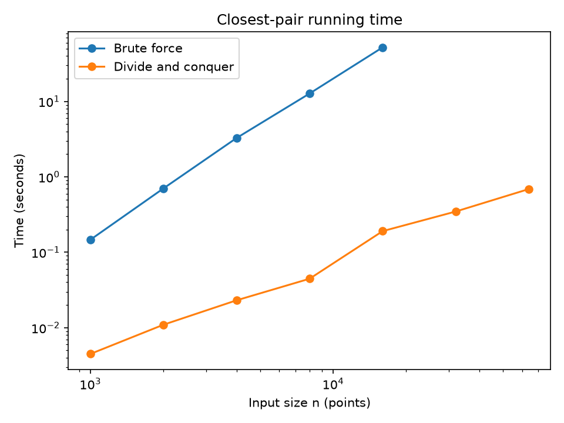

# Assignment 2: Closest Camera Traps

## 1. AI-use statement

I used AI assistant for code drafting and test design. The code was checked against `closest_pair_brute`, including the random tests and the explicit edge cases.

## 2. Approach

The input points are changed internally to triples `(x, y, original_index)`. This preserves the indices from the original input list even after sorting.

`closest_pair_brute` checks every pair. It stores squared distances while comparing pairs and takes one square root for the final answer. It returns the distance and indices in increasing order.

`closest_pair` performs one initial sort by x-coordinate. It divides the sorted list into two halves and recursively solves both halves. Each recursive call returns both its best pair and its points sorted by y-coordinate. The parent merges those y-sorted lists, creates a strip around the dividing line, and checks possible pairs in y-order. The base case has at most three points and uses the brute-force helper.

The implementation keeps the better pair from the two halves before examining the strip. Its strip loop checks at most seven following points for each point. The geometric packing argument says that, after the two halves are known to have minimum distance `delta`, only a constant number of points can be close enough in the strip to improve that answer. The code therefore avoids comparing every strip pair.

## 3. Recurrence and Master Method

The actual recursive implementation merges the two y-sorted results in linear time. Therefore:

**T(n) = 2T(n/2) + Theta(n)**

The term `2T(n/2)` comes from recursively solving the left and right halves. The `Theta(n)` term comes from merging the y-sorted lists, building the strip, and scanning its bounded number of neighbours. The strip scan is linear because each point has only a constant number of useful following neighbours.

For the Master Method, `a = 2`, `b = 2`, and:

**f(n) = Theta(n^(log_b a)) = Theta(n)**

This is Case 2, so the recursive part is **Theta(n log n)**. The initial x-sort is one separate `Theta(n log n)` operation, so it does not change the final asymptotic bound. The brute-force algorithm checks `n(n-1)/2` pairs, giving **Theta(n^2)**.

## 4. Testing summary

The test file contains 504 tests in total. It includes 500 deterministic random tests with list sizes from 2 to 50. Alternating cases use small integer coordinates, which can create ties and duplicate points, and floating-point coordinates. Each random result is compared with `closest_pair_brute`.

The tests also cover exactly two points, duplicate points with answer distance zero, points on one vertical line, and a deliberately constructed closest pair on opposite sides of the dividing line. Each result is checked for increasing indices and checked again by calculating the distance from the returned original input points.

Command run:

```text
python -m pytest test_closest.py
```

Result: **504 passed in 0.87 seconds**.

## 5. Timing results

The benchmark used the same seeded random points for both algorithms at each size. Divide and conquer was averaged over five runs through `n = 4,000` and three runs for larger sizes. Brute force was timed as one run and was recorded as `stopped` after its `n = 32,000` run exceeded 60 seconds. The CSV output was saved as [results.csv](results.csv).

**Table 1. Closest-pair running times and brute-force speed ratio. Units: seconds, except ratio.**

| n | Brute force (s) | Divide and conquer (s) | Brute/D&C ratio |
|---:|---:|---:|---:|
| 1,000 | 0.1464905000 | 0.0044861800 | 32.6537277 |
| 2,000 | 0.7020049000 | 0.0109476200 | 64.1239740 |
| 4,000 | 3.2688997000 | 0.0230682200 | 141.7057623 |
| 8,000 | 12.7337253000 | 0.0446000667 | 285.5091091 |
| 16,000 | 52.1220859000 | 0.1907562667 | 273.2391801 |
| 32,000 | stopped | 0.3471831333 | stopped |
| 64,000 | stopped | 0.6890261667 | stopped |

**Figure 1. Log-log running-time graph. Units: seconds versus number of points.**



The measured brute-force times increased from `0.1464905000` seconds at 1,000 points to `52.1220859000` seconds at 16,000 points. Its available doubling ratios were `4.7921531`, `4.6565198`, `3.8954163`, and `4.0932315`. These values are close to the quadratic doubling pattern on the measured rows, although timing noise and implementation constants affect them.

The divide-and-conquer doubling ratios were `2.440`, `2.107`, `1.933`, `4.277`, `1.820`, and `1.985` for the six successive size increases. Most values were between `1.820` and `2.440`; the `4.277` value at the increase from 8,000 to 16,000 was an isolated larger measurement. The D&C times still increased much more slowly than the brute-force times, and the D&C run at 64,000 points took `0.6890261667` seconds.

## 6. Crossover point and machine information

The benchmark found the first crossover at **n = 22**. It measured each size from 2 through 300 with `timeit`, used three repeats, selected the fastest repeat, and required five consecutive sizes where divide and conquer was faster. The benchmark printed this rule to make the treatment of timing noise explicit.

The run used:

- Python `3.12.10`
- Windows `11` (`10.0.26200-SP0`)
- Processor reported as `Intel64 Family 6 Model 154 Stepping 4, GenuineIntel`

## 7. Critical reflection

### (a) Did the measured growth match the recurrence?

The measurements mostly matched the expected difference between the two algorithms. Brute force had doubling ratios of `4.7921531`, `4.6565198`, `3.8954163`, and `4.0932315` through 16,000 points. These are broadly consistent with quadratic growth, where doubling the input should increase work by about four times. The brute-force run then stopped at 32,000 points because it exceeded 60 seconds.

The D&C ratios were generally near two: `2.440`, `2.107`, `1.933`, `1.820`, and `1.985`, with one larger value of `4.277`. The isolated large value shows that real timing includes noise and fixed costs, but the overall growth was much slower than brute force. This supports the `Theta(n log n)` recurrence for the actual merge-based implementation.

### (b) Why was brute force faster for small inputs?

The crossover was at `n = 22`, so divide and conquer was not always the fastest method for very small lists. It performs an initial sort, recursive calls, y-list merging, strip construction, and function-call work. Brute force has a simple pair loop and little setup. For small `n`, those constant factors can outweigh the better asymptotic growth.

After the crossover, the difference became substantial. At `n = 1,000`, brute force took `0.1464905000` seconds while D&C took `0.0044861800` seconds, a ratio of `32.6537277`. At `n = 8,000`, the ratio was `285.5091091`. This shows why the asymptotically better algorithm matters as the input grows.

### (c) Which edge case was hardest, and how did testing help?

The pair crossing the dividing line was the most important edge case because the answer is not contained entirely in the left or right recursive result. The explicit test placed the closest points on opposite sides of the x-split and expected indices `{2, 3}` with distance `2.0`. This test checks that the strip step is actually used.

The duplicate and vertical-line tests checked different risks: a zero distance and repeated x-coordinates. The 500 random comparisons added broader evidence because every D&C answer was checked against brute force and then checked against the original points. Together, these tests gave evidence that splitting and merging did not lose original indices or miss cross-boundary pairs.


