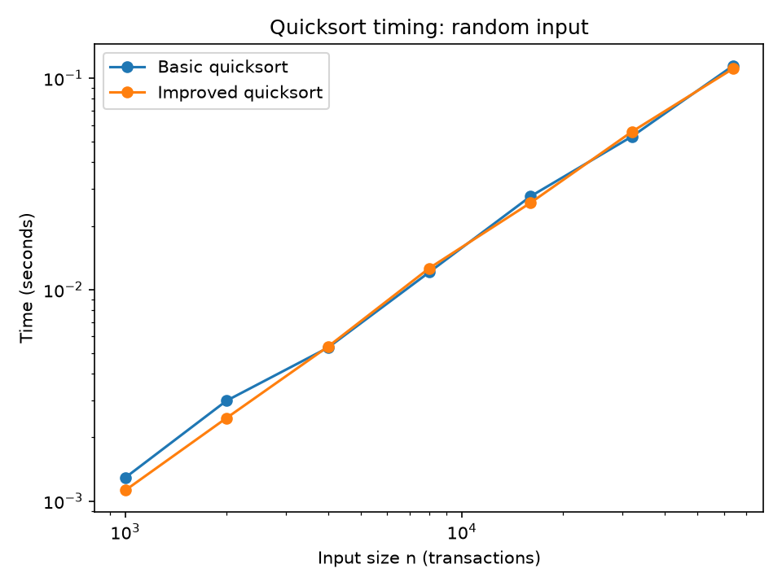
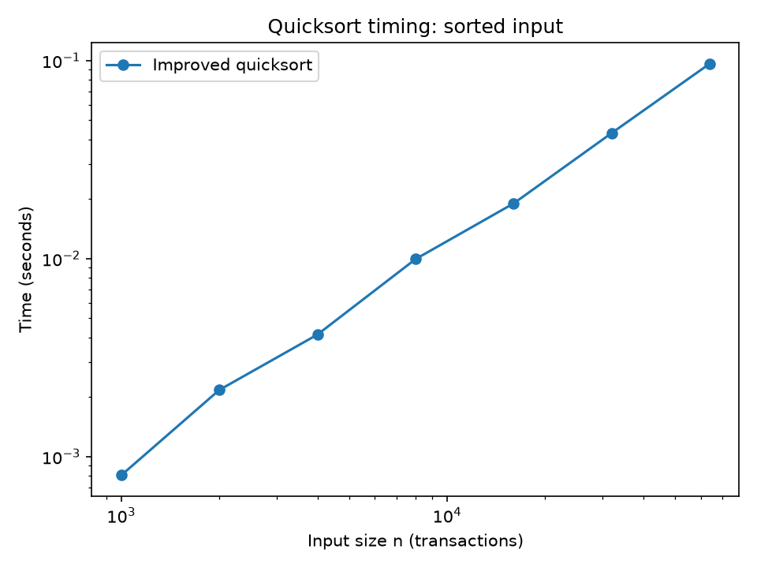
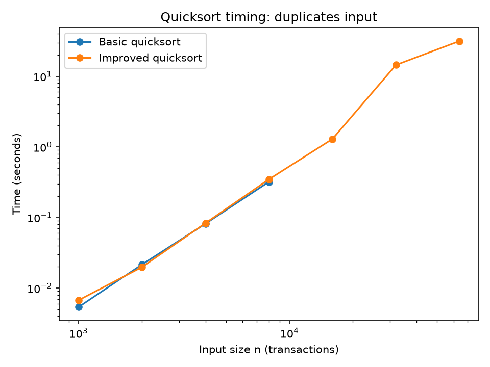

# Assignment 3: Fixing a Slow Quicksort

## 1. AI-use statement

I used an AI assistant (claude) for code drafting, test design, and benchmark structure. I checked all code against `sorted()`, including seeded random tests and explicit edge cases. I reviewed and can explain every submitted line.

## 2. Approach

`quicksort_basic(a)` sorts in place. It uses Lomuto partitioning, always chooses the last element as the pivot, and recursively sorts both partitions. It returns `None`.

`quicksort_improved(a, cutoff)` chooses a random pivot, swaps it to the end, and then reuses the same Lomuto partition. Ranges of at most the cutoff are handled by insertion sort. For larger ranges, the function recursively processes the smaller partition and continues with a loop on the larger partition. The smaller partition contains at most half of the current range, so every recursive level reduces the possible recursive size by at least a factor of two. Consequently, the recursion depth is bounded by `log2(n)`, rather than by the total number of elements. The implementation accepts the tested cutoffs 1, 4, 8, 16, 32, and 64.

The cutoff replaces many small partitioning and function-call operations with insertion sort. The duplicate results show a limitation: Lomuto sends values equal to the pivot to the same side, so groups of equal values can be very unbalanced. Three-way partitioning would be a possible further improvement.

## 3. Why the basic version is slow

On an already sorted list, the last element is the largest element, so the basic algorithm repeatedly produces one empty side and one side of size `n - 1`. A partition scans the range and costs `Theta(n)`. Therefore,

**T(n) = T(n - 1) + Theta(n).**

Expanding gives

`T(n) = T(n - 2) + Theta(n - 1) + Theta(n)`,

and continuing gives a sum proportional to `1 + 2 + ... + n`, which is `Theta(n^2)`. The recursion also has one active call for almost every element. In the benchmark, the basic version recorded `RecursionError` for every sorted size from `n = 1,000` through `64,000`, and for duplicate inputs at 16,000 and above.

For balanced partitions, the usual recurrence is

**T(n) = 2T(n/2) + Theta(n) = Theta(n log n).**

The Master Method applies to this balanced form because the subproblem size is a fixed fraction of `n`. It does not apply to the slow recurrence because `T(n - 1)` is not `T(n/b)` for a fixed `b`.

## 4. Timing results

**Table 1. Random-input timing from the fresh benchmark run.**

| n | Basic quicksort (s) | Improved quicksort (s) |
|---:|---:|---:|
| 1,000 | 0.001290 | 0.001124 |
| 2,000 | 0.002983 | 0.002471 |
| 4,000 | 0.005311 | 0.005372 |
| 8,000 | 0.012090 | 0.012629 |
| 16,000 | 0.027625 | 0.025748 |
| 32,000 | 0.053008 | 0.055846 |
| 64,000 | 0.114706 | 0.111110 |

Random-input doubling ratios were 2.313/2.199, 1.780/2.174, 2.276/2.351, 2.285/2.039, 1.919/2.169, and 2.164/1.990 for basic/improved at successive doublings. These values are broadly near two, with variation from timing noise and randomized pivots.

**Table 2. Already-sorted-input timing. `RecursionError` is the recorded status.**

| n | Basic quicksort | Improved quicksort (s) |
|---:|---|---:|
| 1,000 | RecursionError | 0.000805 |
| 2,000 | RecursionError | 0.002172 |
| 4,000 | RecursionError | 0.004134 |
| 8,000 | RecursionError | 0.009944 |
| 16,000 | RecursionError | 0.019001 |
| 32,000 | RecursionError | 0.043091 |
| 64,000 | RecursionError | 0.096621 |

The improved doubling ratios were 2.698, 1.903, 2.405, 1.911, 2.268, and 2.242. Basic ratios were unavailable because every run raised `RecursionError`.

**Table 3. Many-duplicate-input timing.**

| n | Basic quicksort | Improved quicksort (s) |
|---:|---|---:|
| 1,000 | 0.005371 | 0.006709 |
| 2,000 | 0.021540 | 0.019829 |
| 4,000 | 0.081568 | 0.083039 |
| 8,000 | 0.320349 | 0.347302 |
| 16,000 | RecursionError | 1.293422 |
| 32,000 | RecursionError | 14.453692 |
| 64,000 | RecursionError | 31.512412 |

The duplicate-input basic ratios were 4.010, 3.787, and 3.927 through 8,000; later ratios were unavailable. Improved ratios were 2.956, 4.188, 4.182, 3.724, 11.175, and 2.180. The 11.175 jump and 31.512-second 64,000 result show that the improvement prevents stack failure but does not eliminate Lomuto's poor duplicate handling.

**Figure 1.** Log-log running times for random inputs; missing basic values are not plotted because they were not numeric.

**Figure 2.** Log-log running times for already sorted inputs; the basic series has no numeric points because all measured runs raised `RecursionError`.

**Figure 3.** Log-log running times for inputs whose values were random integers from 0 through 9.

## 5. Cutoff experiment

Each cutoff was measured five times on 100,000 random values. The benchmark reported mean, median, and spread (maximum minus minimum).

**Table 4. Cutoff experiment at n = 100,000.**

| Cutoff | Mean (s) | Median (s) | Spread (s) |
|---:|---:|---:|---:|
| 1 | 0.273214 | 0.260768 | 0.090049 |
| 4 | 0.216438 | 0.216515 | 0.038657 |
| 8 | 0.215656 | 0.219909 | 0.034030 |
| 16 | 0.208100 | 0.197042 | 0.047078 |
| 32 | 0.221751 | 0.215395 | 0.042638 |
| 64 | 0.282988 | 0.264954 | 0.131031 |

The benchmark selected cutoff **16** because it had the lowest mean. Cutoffs 4, 8, and 16 were marked within 5% noise, so their differences are not decisive. Cutoffs 1 and 64 were slower in this run.

## 6. Comparison with Python's `sorted()`

The selected cutoff-16 improved quicksort was compared with `sorted()` on 100,000 values. The final column is the benchmark's `sorted()/quicksort` ratio, formatted to three decimal places.

**Table 5. Best measured quicksort versus `sorted()`.**

| Input | Improved quicksort (s) | `sorted()` (s) | `sorted()`/quicksort |
|---|---:|---:|---:|
| Random | 0.218729 | 0.025039 | 0.114 |
| Sorted | 0.169967 | 0.000948 | 0.006 |
| Duplicates | 50.662681 | 0.009441 | 0.000 |

The duplicate ratio is displayed as 0.000 because it is below the benchmark's three-decimal precision. `sorted()` was faster in every comparison. Timsort exploits existing runs, explaining the 0.000948-second sorted-input time, and its optimized built-in implementation avoids ordinary Python-level loops. Both algorithmic strategy and C-versus-Python cost explain the gap.

## 7. Critical reflection

### (a) Why did basic quicksort fail on sorted data?

I expected the basic algorithm to fail because its last-element pivot is the largest value on an already sorted list. The measurements confirm the prediction: it raised `RecursionError` at the smallest tested size, `n = 1,000`, and at every larger sorted size. This is the operational consequence of repeatedly creating an `n - 1` subproblem and a one-element-or-empty other side. The input violated the average-case assumption that partitions are reasonably balanced. The random-input basic times, from 0.001290 seconds at 1,000 to 0.114706 seconds at 64,000, were much less catastrophic than the sorted case, showing why average-case behavior cannot be assumed for this bank's structured data.

### (b) Why can insertion sort for small parts help?

Insertion sort is `Theta(n^2)` for a large range, but a cutoff applies it only to small ranges. On a small range, its simple loop avoids repeated partition setup, random-pivot selection, and recursive function calls. The cutoff table supports this: cutoff 1 had mean 0.273214 seconds, while cutoff 16 had the best mean, 0.208100 seconds. Cutoff 64 became slower at 0.282988 seconds, so the useful idea is not “use insertion sort everywhere”; it is to use it where the quadratic work is bounded and overhead savings matter. Cutoffs 4, 8, and 16 were within 5% noise, so I would not claim that 16 is universally optimal.

### (c) Why is `sorted()` still faster?

At 100,000 random values, `sorted()` took 0.025039 seconds versus 0.218729 seconds for the improved quicksort, so the measured ratio was 0.114. On sorted input the difference was much larger: 0.000948 seconds versus 0.169967 seconds, ratio 0.006. On duplicates, `sorted()` took 0.009441 seconds while quicksort took 50.662681 seconds. Timsort benefits algorithmically from existing sorted runs and handles these structured inputs well. In addition, the built-in implementation runs optimized sorting operations outside ordinary Python-level loops. Thus both the algorithmic strategy and the C-versus-Python implementation cost explain the gap.

