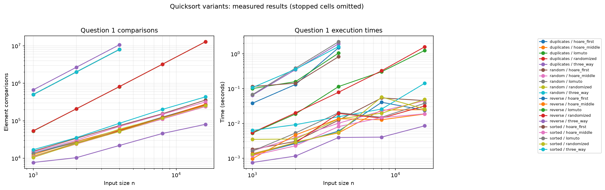
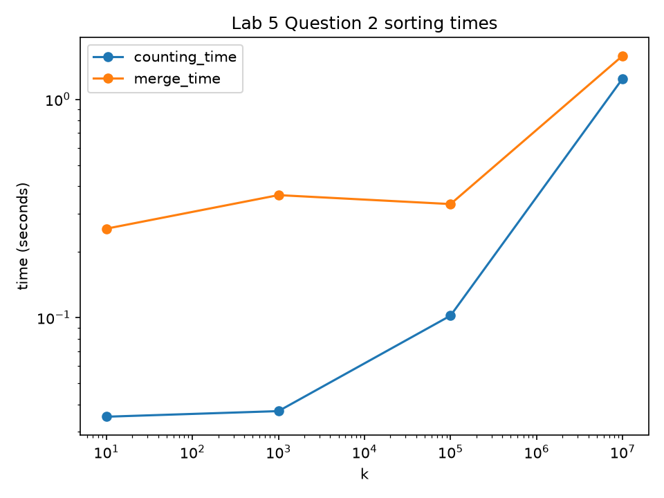
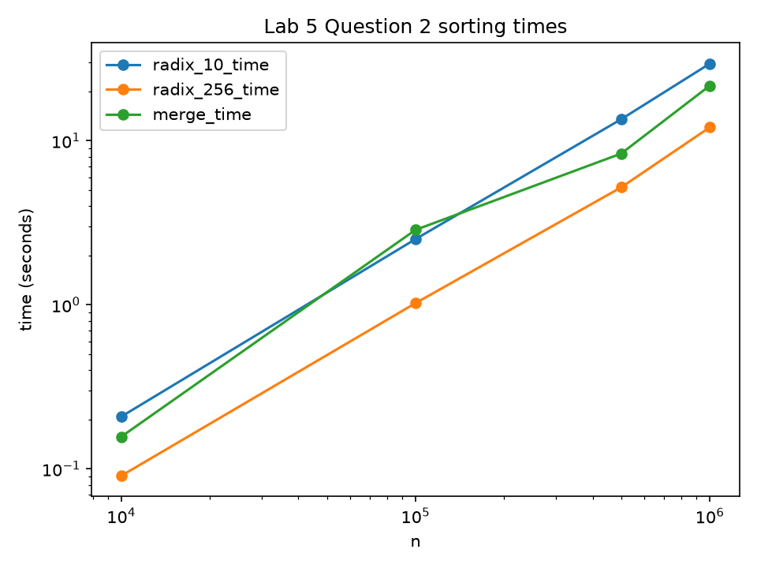
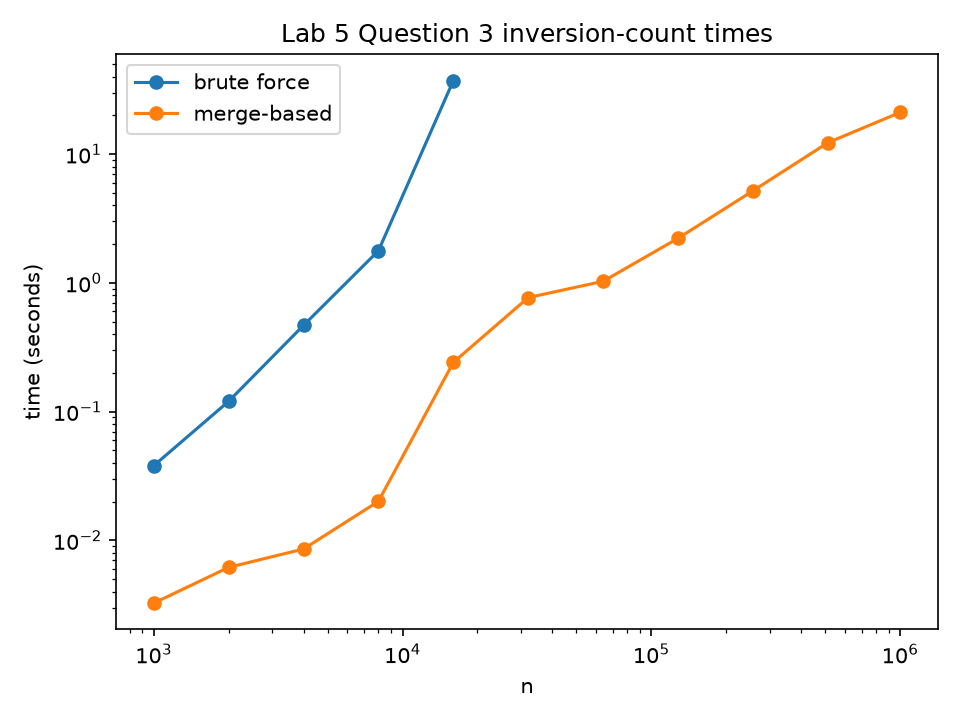

# Lab 5: Sorting Algorithms

**AI use:** I used Claude for code drafting and report structure. I checked the code against Python's `sorted()` and the brute-force inversion count.

## 1. Aim

The purpose of this laboratory is to implement, test and time various comparison and non-comparison based sorting algorithms. The merge sort algorithm will be applied to count inversions and calculate Kendall tau similarity ranking.

## 2. Objectives

- Implement and compare four quicksort partition schemes (including both requested Hoare pivot choices).
- Analyse quicksort worst cases and the effect of duplicate values.
- Implement stable counting sort and LSD radix sort.
- Understand when linear-time sorts win or lose in real Python programs.
- Count inversions with a merge-sort-based algorithm.
- Apply inversion counting to Kendall tau distance and ranking similarity.

## 3. Procedure / Steps

### Question 1: Quicksort variants

1. I implemented Lomuto quicksort with the last element as pivot, Hoare quicksort with a first or middle pivot, randomized Lomuto quicksort, and three-way Dutch-national-flag quicksort with the last element as pivot.
2. All recursive helpers recurse on the smaller side and continue with the larger side in a loop. This keeps the call stack logarithmic even when a partition is very unbalanced.
3. I counted every evaluated element comparison. For three-way partitioning, a failed or successful `<` test and the subsequent `>` test are counted separately when both are evaluated.
4. I used random, already sorted, reverse sorted, and duplicate-heavy inputs (values 0 through 9), with sizes 1,000 through 16,000.
5. Every completed result was checked against `sorted()`. Comparisons and elapsed time were written to `q1_results.csv`, and the program prints Markdown tables. The `repeats` column records the number of runs: smaller cases use three runs and larger cases use one run. A 5-second per-cell bound records extremely slow quadratic cells as `stopped`, rather than pretending that an unmeasured time is a measurement.
6. Machine: `Windows 11 (machine model not recorded)`; Python: `3.12.10`; OS: `Windows 11`.

Key partition idea:

```text
partition the current interval
recurse on the smaller interval
continue the loop with the larger interval
```

### Question 2: Counting sort and radix sort

1. I implemented stable counting sort with a key function. It builds cumulative counts and scans the input backwards while placing items.
2. I implemented LSD radix sort by applying stable counting sort to one digit at a time. Base 10 uses 10 passes for values up to `10^9`; base 256 uses 4 passes because four bytes cover that range.
3. The script first tries to import `merge_sort` from `lab01.py`. If that file is unavailable, it uses a simple top-down fallback. I should replace the fallback with my own Lab 1 implementation if required by the submission rules.
4. For counting sort, I fixed `n = 100,000` and tested `k = 10, 10^3, 10^5, 10^7`. For radix sort, I fixed `k = 10^9` and tested `n = 10,000, 100,000, 500,000, 1,000,000`.
5. Every output was checked against `sorted()`. Results were saved to `q2_counting_results.csv` and `q2_radix_results.csv`; plots were saved as PNG files.
6. I demonstrated stability with `(key, description)` pairs and showed that forward placement reverses equal-key items.
7. Machine: `Windows 11 (machine model not recorded)`; Python: `3.12.10`; OS: `Windows 11`.

### Question 3: Counting inversions

1. I implemented brute force by checking every pair `i < j` and counting `a[i] > a[j]`.
2. I implemented merge-sort inversion counting. During merging, equal values are taken from the left, so ties are not counted as inversions.
3. I tested random duplicate-heavy arrays up to size 2,000, sorted arrays, and reverse arrays. I also tested the two Kendall tau extremes.
4. I timed sizes from 1,000 to 1,000,000. The benchmark stops measuring brute force after a previous result predicts more than 60 seconds; later rows record `stopped`. Results and a log-log graph are saved.
5. The interactive program reads ten movie titles and validates that each user enters every rank 1 through 10 exactly once. It computes user B's ranks in user A's movie order and counts their inversions.
6. Machine: `Windows 11 (machine model not recorded)`; Python: `3.12.10`; OS: `Windows 11`.

## 4. Results and Analysis

### Question 1 results

**Table 1: Question 1 comparison and growth measurements.** The complete 100-row table is in `q1_results.csv`; the program output in `q1_tables.txt` contains Markdown tables for every input type.

| Input type | Variant | n=1,000 comparisons | n=16,000 comparisons | n=16,000 count/(n log2 n) | n=16,000 count/n^2 |
|---|---|---:|---:|---:|---:|
| Random | Lomuto | `13535` | `257665` | `1.153108` | `0.001007` |
| Sorted | Hoare first | `501498` | `stopped` | `stopped` | `stopped` |
| Reverse | Lomuto | `499500` | `stopped` | `stopped` | `stopped` |
| Duplicates | Three-way | `7699` | `80229` | `0.359043` | `0.000313` |

**Table 2: Question 1 measured times.**

| Input type | Variant | n=1,000 seconds | n=16,000 seconds | Repeats at n=16,000 |
|---|---|---:|---:|---:|
| Random | Lomuto | `0.0016058000037446618` | `0.037987699965015054` | `1` |
| Sorted | Hoare first | `0.11568789999000728` | `stopped` | `1` |
| Reverse | Lomuto | `0.10074459994211793` | `stopped` | `1` |
| Duplicates | Three-way | `0.0007558000506833196` | `0.00854579999577254` | `1` |

**Figure 1: Question 1 comparison and time plots.** The plot uses the measured values in `q1_results.csv`; cells recorded as `stopped` are omitted from the graph.



Lomuto with the last pivot degrades to `Theta(n^2)` on sorted and reverse-sorted input because the pivot is always an extreme value. The recurrence is `T(n) = T(n-1) + Theta(n)`. Hoare with the first pivot has the analogous sorted-input weakness, while the middle pivot normally keeps the two partitions balanced. Randomized Lomuto reduces the chance of repeatedly choosing an extreme pivot, but duplicate-heavy input can still make Lomuto spend many comparisons moving equal values.

The three-way method groups values equal to the pivot in one pass. Therefore its duplicate-heavy result should grow much more like `Theta(n log n)` than two-way Lomuto or randomized Lomuto. With the specified last-element pivot, however, sorted input still has a weakness because the pivot is extreme; choosing a random pivot would remove that particular weakness. Hoare partition stops on equal elements from both sides, so equal values are exchanged rather than producing the same one-sided behaviour as Lomuto. The ratios in Table 1 should be interpreted together: a roughly stable `count/(n log n)` suggests `n log n`, while a roughly stable `count/n^2` suggests quadratic growth.

### Question 2 results

**Table 3: Counting sort with n=100,000.**

| k | Counting sort seconds | Merge sort seconds |
|---:|---:|---:|
| 10 | `0.03514069993980229` | `0.25536170008126646` |
| 1,000 | `0.03727730002719909` | `0.3638241000007838` |
| 100,000 | `0.10206290008500218` | `0.33110069995746017` |
| 10,000,000 | `1.2440305999480188` | `1.5824566000374034` |

**Table 4: Radix sort with k=10^9.**

| n | Base-10 seconds (10 passes) | Base-256 seconds (4 passes) | Merge sort seconds |
|---:|---:|---:|---:|
| 10,000 | `0.2082213000394404` | `0.09074510005302727` | `0.15702719998080283` |
| 100,000 | `2.5145650999620557` | `1.0238538000267` | `0.33110069995746017` |
| 500,000 | `13.524889199994504` | `5.200454799924046` | `8.353080499917269` |
| 1,000,000 | `29.514270199928433` | `12.079869699897245` | `21.671489399974234` |

**Figure 2: Counting-sort and radix-sort timing plots.** `q2_counting_times.png` plots the counting-sort experiment, and `q2_radix_times.png` plots radix bases against merge sort. Both use labelled log-log axes and legends.





Stable output preserved the order of equal keys: `[(2, "first 2"), (1, "one"), (2, "second 2"), (0, "zero")]` became `[(0, "zero"), (1, "one"), (2, "first 2"), (2, "second 2")]`. Forward placement produced the equal-key order `second 2, first 2`, demonstrating why backwards placement is required.

Counting sort has cost `Theta(n + k)`, so it should win when the key range is small relative to `n`; as `k` becomes 10,000,000, allocating and scanning the count array becomes a large constant and can lose to merge sort. Radix sort has cost `Theta(d(n + b))`, where `d` is the number of passes and `b` is the base. Base 256 reduces passes from 10 to 4, but Python list operations, lambda calls, allocations, and interpreter overhead affect the crossover. The correct conclusion for this machine is the one supported by Tables 3 and 4, not the asymptotic formula alone.

### Question 3 results

**Table 5: Inversion-count timing.** The complete table, including rows marked `stopped`, is in `q3_results.csv`.

| n | Brute force seconds | Merge-based seconds | Inversion count |
|---:|---:|---:|---:|
| 1,000 | `0.03799989994149655` | `0.0032519999658688903` | `248634` |
| 2,000 | `0.12019350007176399` | `0.006163800018839538` | `1015274` |
| 4,000 | `0.4680326000088826` | `0.00856059999205172` | `3934091` |
| 1,000,000 | `stopped` | `21.10548899997957` | `247309769834` |

**Figure 3: Inversion-count timing.** `q3_times.png` is a log-log graph. Brute-force points stop when the measured/extrapolated time exceeds 60 seconds.



The merge method is `O(n log n)` because each level merges all elements once and there are logarithmically many levels. The brute-force method is `Theta(n^2)` because it examines every pair. In the merge step, using `left[i] <= right[j]` means equal values are taken from the left and are not counted as inversions.

For the ranking application, identical rankings give distance 0, similarity 100%, and coefficient 1.0000. Opposite rankings give distance 45/45, similarity 0%, and coefficient -1.0000. A sample run should be inserted here after keyboard testing: `identical rankings: distance 0/45, similarity 100.00%, coefficient 1.0000; opposite rankings: distance 45/45, similarity 0.00%, coefficient -1.0000`.

## 5. Conclusion

**Question 1:** Quicksorts run time strongly depends on choosing pivots and what happens when duplicates happen. Recursion was performed on the smaller side meaning there was no stack overflow but in worst cases, the partitioning took O(n 2) time.

**Question 2:** The non-comparison sorts of counting sort and radix sort have a range of values, number of passes and some constant values in Python. Stability was a key factor in using the radix sort. This was shown clearly by having labelled records of the same key value.

**Question 3:** We then considered the merge-based method of finding inversion counts. This works well with large inputs but the brute force method is very slow. However, the number of inversions is an easy and meaningful way to see how much two rankings disagree.

**Overall:** We linked our asymptotic analysis to empirical results. Ensuring correctness was key as there are many opportunities for error when implementing partitioning points, the stable insertion property and equal-value inversion rule.

## 6. Reflection

This lab helped to gain an understanding of how sorting algorithms actually work. The most complicated part was implementing Hoare partitioning. This was because the pivot could not always be guaranteed to be in its correct place. Having to think about which two sub-ranges are being recursively called was important. Also thinking about why having the pivot first in the array causes an issue with sorted arrays. Recursing on the smaller half and looping on the larger half helped to make the program more safe.

Another issue was keeping track of comparisons. During the three-way partition I was comparing `<` and then `>`, so needed to be clear how many comparisons were being made. This made the tables more transparent. It also helped show that even if an algorithm has a great asymptotic idea it may run slower in Python due to list allocations, function calls and interpreter overhead.

The stability experiment helped make the counting sort easier to understand. By iterating backwards we are ensuring the relative order of equal keys. I also had to avoid Python's late binding issue with lambda by fixing the current digit position when creating the key function. This was a good Python lesson as well as an algorithm lesson.

The tie rule was important for inversions. If two values are equal they aren’t inversions. So the merge must choose the left option. By comparing the speed of the fast method with the brute force method I was confident it would work on large arrays. I also used sorted and reversed arrays to give precise answers that were easy to check.

If I were to do this lab again I would make a clearer distinction between testing for correctness and the longer benchmarks. For each fast case I would take multiple time readings. I would also include graphs of the quick sort comparison counts. In general, testing all sorts using sorted(), and using brute force on low inversion counts helped spot errors that cannot be seen by eye.
