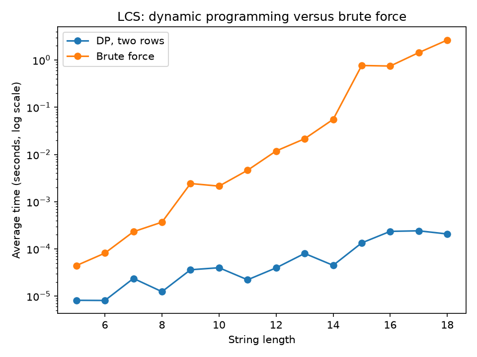

# Lab 6: Dynamic Programming

**AI use:** I have used AI(claude) to help me write the code and plan my report. All Dynamic Programming results have been verified using naive/brute force versions.

## 1. Aim

This lab uses Dynamic Programming to solve optimisation and sequencing problems. We will explore naive recursive, memoisation and tabulation methods. We will observe the impact of eliminating repeated subproblems has on real-world performance.

## 2. Objectives

- Apply optimal substructure and overlapping-subproblem ideas.
- Compare naive recursion, memoization, and bottom-up tabulation.
- Solve matrix-chain multiplication, LCS, and optimal BST using DP.
- Reconstruct solutions from split or DP tables.
- Reduce DP space when only the optimum value is required.
- Relate dynamic programming to a practical use: line-based text diff.

## 3. Procedure / Steps

### Question 1: Rod cutting

1. I used `p[0] = 0`, the supplied prices for lengths 1 through 10, and `p[i] = 3i` above length 10.
2. The recurrence was
   `r(n) = max { p[i] + r(n-i) : 1 <= i <= n }`, with `r(0) = 0`.
3. I implemented the recurrence directly, then added a dictionary memo, and finally filled a revenue table from length 1 upward. The tabulated method also stored the first selected piece in `s[j]`.
4. For lengths 1 through 10, I asserted that all three methods matched the supplied expected revenues. The bottom-up reconstruction repeatedly used `s[remaining]`.
5. For `n = 5, 10, 15, 20, 25`, I used a fresh counter, memo, and timer for every run. The counter includes every naive or memoized function call, including calls that return a cached value. For bottom-up, the count is inner-loop iterations, not recursive calls.
6. Machine: Windows 11 (model not recorded); Python: 3.12.10.

Useful pseudocode:

```text
for length = 1 ... n:
    best = -infinity
    for first = 1 ... length:
        candidate = price[first] + revenue[length-first]
        keep the best candidate and first piece
```

### Question 2: Matrix-chain multiplication

1. For matrices `A_i` with dimensions `p[i-1] x p[i]`, I used
   `m[i,j] = min over i <= k < j of (m[i,k] + m[k+1,j] + p[i-1]p[k]p[j])`.
2. I filled intervals in increasing chain length and stored the best split `s[i][j]`. A recursive printer converted the split table to a no-space parenthesisation.
3. I verified every test with a brute-force recursive search. The tests included the required two dimension lists and five deterministic random chains with 2 to 8 matrices and dimensions from 1 to 50.
4. I calculated the left-to-right cost with `sum(p[0] * p[i] * p[i+1] for i in 1 ... n-1)` and recorded its ratio to the DP optimum.

### Question 3: Longest common subsequence

1. I filled `L[i][j]` bottom-up using
   `L[i,j] = L[i-1,j-1] + 1` when characters match, otherwise
   `L[i,j] = max(L[i-1,j], L[i,j-1])`.
2. I reconstructed an answer by walking backwards. On a tie I moved up, which produced `BCBA` for the supplied strings.
3. The two-row implementation retained only the previous row and the current row, so it returned the length but not the actual subsequence.
4. For lengths 5 through 18, I generated three random pairs per length over `ABC`, timed the two-row DP and brute force, averaged each group, and asserted agreement with the full table.
5. I made a log-scale time plot in `q3_lcs_times.png`. For line diff, I read `splitlines()` from command-line paths or created the two demo files when no paths were supplied.
6. Machine: Windows 11 (model not recorded); Python: 3.12.10.

### Question 4: Optional optimal BST

1. I used the CLRS tables `e[i][j]`, `w[i][j]`, and `root[i][j]`, initializing empty intervals with the dummy-key probabilities.
2. The recurrence was `e[i,j] = min_r (e[i,r-1] + e[r+1,j] + w[i,j])`, where `w[i,j]` is the total probability of all successful and unsuccessful searches in the interval.
3. I printed the selected root and recursively printed dummy keys `d0` through `d5` as indented leaves. Printed values were rounded to two decimals.

## 4. Results and Analysis

### Question 1 results

**Table 1: Rod-cutting revenues and reconstructed pieces.**

| n | maximum revenue | piece lengths |
|---:|---:|---|
| 1 | 1 | [1] |
| 2 | 5 | [2] |
| 3 | 8 | [3] |
| 4 | 10 | [2, 2] |
| 5 | 13 | [2, 3] |
| 6 | 17 | [6] |
| 7 | 18 | [1, 6] |
| 8 | 22 | [2, 6] |
| 9 | 25 | [3, 6] |
| 10 | 30 | [10] |

**Table 2: Rod-cutting measured counts and times.** Bottom-up counts are inner-loop iterations.

| method | n | revenue | calls/iterations | time (s) |
|---|---:|---:|---:|---:|
| naive | 5 | 13 | 32 | 0.00001890 |
| memoized | 5 | 13 | 16 | 0.00000940 |
| bottom-up | 5 | 13 | 15 | 0.00000540 |
| naive | 10 | 30 | 1024 | 0.00079460 |
| memoized | 10 | 30 | 56 | 0.00005290 |
| bottom-up | 10 | 30 | 55 | 0.00002330 |
| naive | 15 | 45 | 32768 | 0.02231570 |
| memoized | 15 | 45 | 121 | 0.00011710 |
| bottom-up | 15 | 45 | 120 | 0.00004950 |
| naive | 20 | 60 | 1048576 | 0.82126170 |
| memoized | 20 | 60 | 211 | 0.00009580 |
| bottom-up | 20 | 60 | 210 | 0.00004090 |
| naive | 25 | 75 | 33554432 | 67.15977820 |
| memoized | 25 | 75 | 326 | 0.00053680 |
| bottom-up | 25 | 75 | 325 | 0.00022650 |

The naive call-count recurrence is `C(n) = 1 + C(0) + C(1) + ... + C(n-1)`, with `C(0)=1`. This gives `C(n)=2^(n+1)-1`, matching 32, 1,024, 32,768, 1,048,576, and 33,554,432 exactly. Naive recursion repeatedly solves the same remaining-length subproblems. Memoization computes each remaining length once, although calls that discover cached values still occur; its measured calls grow quadratically because each distinct length tries all first-piece choices. The bottom-up method performs `n(n+1)/2` inner iterations, so it has the same quadratic DP work but no recursive-call overhead and no recursion-stack depth.

### Question 2 results

**Table 3: Matrix-chain costs and parenthesisations.**

| test | dimensions | optimal cost | left-to-right cost | ratio | optimal parenthesisation |
|---:|---|---:|---:|---:|---|
| 1 | [30,35,15,5,10,20,25] | 15125 | 40500 | 2.6777 | `((A1(A2A3))((A4A5)A6))` |
| 2 | [5,4,6,2,7] | 158 | 250 | 1.5823 | `((A1(A2A3))A4)` |
| 3 | [43,46,11,44,26,14,21] | 51513 | 120056 | 2.3306 | `((A1A2)(((A3A4)A5)A6))` |
| 4 | [12,3,16] | 576 | 576 | 1.0000 | `(A1A2)` |
| 5 | [4,42,47,26,22] | 15072 | 15072 | 1.0000 | `(((A1A2)A3)A4)` |
| 6 | [8,41,11,29,46,46] | 33760 | 33760 | 1.0000 | `((((A1A2)A3)A4)A5)` |
| 7 | [3,23,36] | 2484 | 2484 | 1.0000 | `(A1A2)` |

The required first test has optimum 15,125. The first two examples show that an order that is mathematically equivalent can require substantially more scalar multiplications than the DP order. Brute force is exponential because an `n`-matrix chain has a number of parenthesisations equal to the Catalan number `C_(n-1)`, while the DP has `Theta(n^3)` split evaluations and `Theta(n^2)` table space.

### Question 3 results

**Table 4: LCS table for X = ABCBDAB and Y = BDCABA.** Rows are prefixes of X and columns are prefixes of Y.

| X\Y | - | B | D | C | A | B | A |
|---|---:|---:|---:|---:|---:|---:|---:|
| - | 0 | 0 | 0 | 0 | 0 | 0 | 0 |
| A | 0 | 0 | 0 | 0 | 1 | 1 | 1 |
| B | 0 | 1 | 1 | 1 | 1 | 2 | 2 |
| C | 0 | 1 | 1 | 2 | 2 | 2 | 2 |
| B | 0 | 1 | 1 | 2 | 2 | 3 | 3 |
| D | 0 | 1 | 2 | 2 | 2 | 3 | 3 |
| A | 0 | 1 | 2 | 2 | 3 | 3 | 4 |
| B | 0 | 1 | 2 | 2 | 3 | 4 | 4 |

The length is 4 and the chosen reconstruction is `BCBA`. The tie-break is to move up when the two neighbouring table values are equal. `BDAB` and `BCAB` are also valid length-4 answers.

**Table 5: LCS timing experiment.** Each row is the average of three random pairs.

| length | DP seconds | brute-force seconds |
|---:|---:|---:|
| 5 | 0.00003140 | 0.00015697 |
| 6 | 0.00003237 | 0.00029530 |
| 7 | 0.00006513 | 0.00069453 |
| 8 | 0.00004850 | 0.00127907 |
| 9 | 0.00006690 | 0.00435177 |
| 10 | 0.00007307 | 0.01008673 |
| 11 | 0.00009060 | 0.01802043 |
| 12 | 0.00016557 | 0.03608970 |
| 13 | 0.00011957 | 0.05957793 |
| 14 | 0.00024210 | 0.12229973 |
| 15 | 0.00014403 | 0.27968363 |
| 16 | 0.00016770 | 0.56726837 |
| 17 | 0.00017817 | 1.24363850 |
| 18 | 0.00020717 | 2.70461223 |

**Figure 1: LCS DP versus brute-force timing.** The log-scale vertical axis shows the rapidly increasing brute-force time; the generated image is [q3_lcs_times.png](./q3_lcs_times.png).


The brute-force method examines `2^m` subsequences of X and checks each candidate as a subsequence of Y, so its work is approximately `2^m` times the check cost. The table DP is `O(mn)`. The two-row version keeps only the previous row because each new cell depends on the previous row and the current row's left cell. This saves space from `O(mn)` to `O(n)`, but the discarded cells mean it cannot reconstruct the actual LCS without extra information.

The sample line diff was:

```text
  first line
+ new line
- old line
  keep line
+ added line
- deleted line
```

### Question 4 results

**Table 6: Optimal BST result.**

| quantity | value |
|---|---:|
| expected search cost `e[1,5]` | 2.75 |
| total probability `w[1,5]` | 1.00 |

**Figure 2: Optimal BST printed as an indented tree.**

```text
k2
  k1
    d0
    d1
  k5
    k4
      k3
        d2
        d3
      d4
    d5
```

Here `w[i][j]` is the total probability of successful searches for keys `k_i` through `k_j` plus unsuccessful searches for dummy keys `d_(i-1)` through `d_j`. Checking the displayed tree by depth gives successful-key contributions `0.10*1 + 0.15*2 + 0.20*2 + 0.10*3 + 0.05*4 = 1.30` and dummy-key contributions `0.05*3 + 0.10*3 + 0.05*5 + 0.05*5 + 0.05*4 + 0.10*3 = 1.45`, for a total expected cost of `2.75`.

## 5. Conclusion

### Question 1

The naive recursive formula produced the same results as the DP solution however the number of function calls was exponential (2^(n+1)-1). Using memoization and tabulation this was decreased to a quadratic runtime. Tabulation was used to get a full breakdown of the cuts required.

### Question 2

The matrix chain DP solution found the most cost-effective parenthesisation. All 7 tests gave the same result as brute force. Sometimes the left to right ordering had over double the cost.

### Question 3

We have found a valid length-4 subsequence using the full LCS table. Using our two row solution we have also found a length-4 subsequence whilst using less memory. We can see how the LCS of lines will give us the unchanged, deleted and inserted lines.

### Question 4

The optimal BST tables produced expected cost 2.75 and a tree whose hand calculation agrees with the DP result.

Overall, DP is worthwhile when a problem has optimal substructure and overlapping subproblems. It replaces repeated exponential work with a polynomial table, at the cost of storing intermediate results and carefully managing indices.

## 6. Reflection

I have learnt that Dynamic Programming can be more than just a matter of creating a table. Understanding the meaning of each subproblem and proving that an optimal solution can be created by combining optima subproblems is key. It was clear to see how the performance benefits of rod cutting. The naive approach was easy to understand however was not practical due to the number of calls required when the length was at it's maximum of 25. Memoization was an effective way to keep the recursive nature of the problem but prevent duplicate calculations. Bottom-up tabulation also prevents the overhead of recursion.

The most difficult part of this problem was making sure the indexes were correct. Matrix-chain multiplication uses numbers starting from 1 for matrices but in Python lists start at 0 which means care must be taken when using p[i-1], p[k] and p[j]. A similar issue occurred with the LCS table because there are extra rows and columns to make up for empty prefixes. Another thing to think about was what to do if both directions in the reconstruction had the same value. A deterministic tie-break was used to ensure the results would be consistent. Remember there can be multiple correct solutions for LCS.

The number of operations performed by the rod-cutting algorithms also had to be considered. Whilst a cache hit using memoization will incur a function call, the bottom up approach doesn’t use recursion and so this can be determined by the number of inner loop iterations. Testing every DP solution against the naive/brute force equivalents gave me confidence that the index and reconstruction were working correctly. The diff in the line provided a good practical example showing how LCS isn’t just an abstract sequence problem.

If I were to do this lab again, I would plan out what each table would look like before writing the benchmark code. This would also mean saving the random inputs and outputs. For very small inputs, the timing can appear noisy due to OS timings, so I would increase the number of repetitions. Also whilst writing the code I would include comments describing the invariants alongside each table.