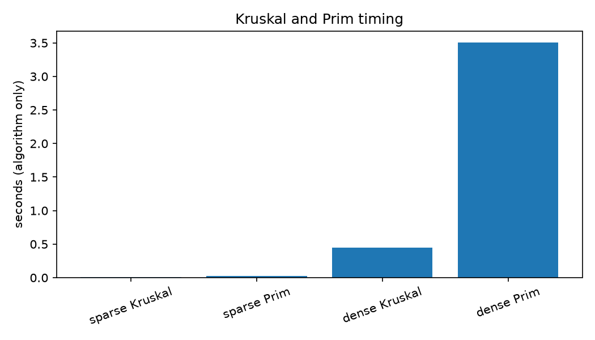
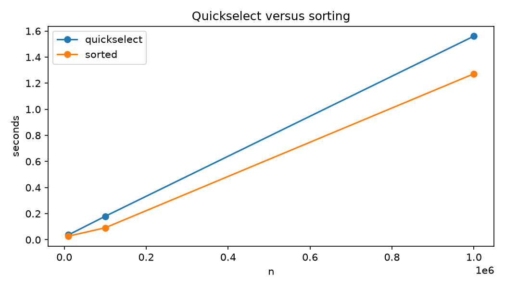

# Lab 7: Greedy and Randomized Algorithms
 
**AI use:** I used copilot to help write the code, and create a template for the report. The results were verified using brute force, dynamic programming, sorted() and trial division.

## Aim

The aim of this lab is to implement and experimentally analyse greedy and randomised algorithms. The purpose of experimentation is to observe how the theoretical guarantees match up against the real world. Independent verification will be used to see when a tempting heuristic doesn't work.

## Objectives

- Apply the greedy-choice property and recognise when it fails.
- Implement activity selection, fractional knapsack, Huffman coding, Dijkstra, Kruskal and Prim.
- Understand why Dijkstra requires non-negative edge weights.
- Implement randomized quickselect and Miller-Rabin primality testing.
- Analyse expected running time and one-sided probabilistic error.

## Procedure / Steps

### Q1: Activity selection and knapsack

1. `lab07_q1.py` reads one `start finish` pair per line from a file or keyboard.
2. Activity selection sorts by earliest finish time. A candidate is accepted only when it is compatible with every already accepted activity:

   ```text
   for activity in sorted_by_finish:
       if activity.start >= every accepted.finish (or it is disjoint):
           accept activity
   ```

3. Earliest-start and shortest-duration rules were implemented with the same all-accepted-activities check. Random inputs contained 3--6 activities, starts from 0--10 and durations from 1--6.
4. A brute-force combination search checked the earliest-finish count on 500 random inputs.
5. Fractional knapsack sorts by value/weight and takes the remaining fraction of the next item.
6. The same ratio order was used for 0/1 knapsack. A capacity-indexed dynamic program independently computed the optimum. Five thousand random instances were tested, with weights 1--20, values 1--50, 3--10 items and random capacity.
7. **Machine:** Microsoft Windows, Python 3.12.10. Random seed: 302.

### Q2: Huffman coding

1. `lab07_q2.py` opens each file with `open(path, "rb")` equivalent through `Path.read_bytes()`, so every byte is one symbol and fixed-length storage is exactly 8 bits per symbol.
2. A min-heap stores `(frequency, counter, node)`. The counter prevents Python from comparing tree objects when frequencies tie.
3. The tree is traversed to make codes, the bytes are encoded to a bit string, and the bit string is decoded. The decoded bytes must equal the original bytes, and no code may be a prefix of another.
4. Empty and one-symbol inputs are handled specially. Three small files were used: English prose, Python source, and repeated text.
5. The reported compression ratio is `encoded_bits / (8 * original_bytes)` and excludes the cost of storing the code table.

### Q3: Shortest paths and minimum spanning trees

1. Graph files use this format: the first line is `V E`, followed by exactly `E` lines of `u v w`. Edges are directed for Dijkstra. For MST algorithms, each listed edge is treated as undirected.
2. Dijkstra uses `heapq`. With `finalise=True`, a vertex is finalised on its first pop. With `finalise=False`, only stale heap entries are skipped, so a later improvement can still be processed.
3. Kruskal sorts edges and uses union-find with path compression and union by rank. Prim uses an adjacency list and a heap.
4. Random connected graphs were made by first adding a random spanning tree, then adding extra edges. Kruskal and Prim were compared on totals, and both were required to return exactly `n-1` edges.
5. For timing, adjacency lists were built before the timed region. `V=1000`, sparse graphs had `E=2999`, dense graphs had `E=250000`, and each algorithm was repeated three times.
6. The negative-edge file was checked with Bellman-Ford. The graph is `3 3`, `(0,1,2)`, `(0,2,3)`, `(2,1,-2)`.

### Q4: Randomized algorithms

1. Quickselect copies the input and repeatedly makes three lists: values below, equal to, and above a random pivot. This handles duplicates. Results were checked against `sorted(a)[k-1]` for minimum, median, maximum and random ranks.
2. Median selection was timed for `n=10^4`, `10^5`, and `10^6`, three times each. Both methods included the input-copying effect; `sorted()` itself is implemented in C.
3. Miller-Rabin first checks small primes, then performs 20 random rounds. Trial division checks every odd divisor up to the square root.
4. Both primality methods were compared on 20 random 12-digit numbers, five confirmed 12-digit primes, and every integer from 0 through 2999.
5. For the Carmichael experiment, exactly `mr_round(561, random.randrange(2, 560))` was called 1000 times. This avoids the small-prime pre-check hiding the experiment.

## Results and Analysis

### Q1 results

**Table 1: Activity-selection counterexamples and 0/1 knapsack search**

| Rule | Input | Earliest-finish selection | Alternative selection |
|---|---|---|---|
| Earliest start | `(7,9),(0,4),(6,8),(8,12),(5,11),(1,7)` | `(0,4),(6,8),(8,12)` (3) | `(0,4),(5,11)` (2) |
| Shortest duration | `(9,13),(9,15),(8,14),(8,12),(4,9)` | `(4,9),(9,13)` (2) | `(8,12)` (1) |

The earliest-finish rule leaves the largest possible remaining time after each choice. Earliest start can choose an activity that occupies most of the useful middle of the schedule. Shortest duration can choose a short activity in a strategically bad position. The brute-force tests found no earliest-finish mismatch.

The worst random 0/1 ratio found was **0.212121**: items `(weight,value) = (14,28),(1,7),(15,43),(11,33)`, capacity 11. Ratio-greedy selected value 7, while DP selected value 33. This is the worst **found** in the stated random search, not a proof of the worst possible ratio. A hand-built poor example is capacity 50 with `(25,99),(50,198),(26,100)`: ratio-greedy takes the first item for 99, while the optimum takes the 50-weight item for 198. Greedy 0/1 is not fractional because it cannot split an item; DP is needed for the exact discrete optimum. For fractional knapsack, taking the highest remaining value/weight ratio is optimal by an exchange argument.

### Q2 results

**Table 2: Huffman compression measurements (code-table cost excluded)**

| File | Bytes | Encoded bits | Average bits/symbol | Ratio |
|---|---:|---:|---:|---:|
| `sample_english.txt` | 191 | 836 | 4.377 | 0.5471 |
| `sample_source.py` | 138 | 579 | 4.196 | 0.5245 |
| `sample_repeated.txt` | 39 | 99 | 2.538 | 0.3173 |

**Table 3: Huffman code table for the repeated sample**

| Symbol | Frequency | Code |
|---|---:|---|
| `'A'` | 15 | `0` |
| `'B'` | 6 | `100` |
| `'R'` | 6 | `101` |
| `'C'` | 3 | `1100` |
| `'D'` | 3 | `1101` |
| `'\r'` | 3 | `1110` |
| `'\n'` | 3 | `1111` |

Every round trip decoded exactly to the original bytes, and all code tables were prefix-free. The repeated file compressed best because a few symbols dominate its distribution. The ratios exclude metadata: a real compressed file also needs the tree or frequency table, so these tiny files may compress less well after that overhead.

### Q3 results

**Table 4: Dijkstra and MST outputs**

| Check | Result |
|---|---|
| Sample Dijkstra distances from 0 | `0:0`, `1:7`, `2:9`, `3:20`, `4:14`, `5:11` |
| Kruskal MST | weight 27, 5 edges |
| Prim MST | weight 27, 5 edges |
| Negative example, finalising Dijkstra | `[0, 2, 3]` |
| Negative example, lazy Dijkstra | `[0, 1, 3]` |
| Negative example, Bellman-Ford | `[0, 1, 3]` |

The negative edge gives the path `0 -> 2 -> 1` weight `3 + (-2) = 1`, but finalising Dijkstra has already finalised vertex 1 at distance 2, so it reports 2. The lazy version happens to repair the value here. It does not restore the textbook guarantee and can lose the desired complexity on unsuitable graphs.

**Table 5: MST timings, algorithm-only region, three repetitions**

| Graph | Edges | Kruskal mean (s) | Prim mean (s) | MST total |
|---|---:|---:|---:|---:|
| Sparse | 2,999 | 0.010115 | 0.027761 | 20,444 |
| Dense | 250,000 | 0.445294 | 3.504102 | 1,011 |



**Figure 1: Measured MST timing for sparse and dense graphs.**

Kruskal won in both measurements on this implementation. Both heap/sort approaches are commonly described as `O(E log V)` here, so constants matter: Kruskal performs one sort and union-find operations, whereas heap-based Prim can push many adjacency entries. An array-based Prim implementation is `O(V^2)` and is often attractive for dense graphs, although this experiment used the heap version.

### Q4 results

**Table 6: Quickselect versus sorting for the median**

| n | Quickselect mean (s) | `sorted()` mean (s) |
|---:|---:|---:|
| 10,000 | 0.036939 | 0.027247 |
| 100,000 | 0.179832 | 0.091788 |
| 1,000,000 | 1.560603 | 1.272222 |



**Figure 2: Median-selection timing.**

Quickselect has expected `O(n)` time, while comparison sorting is `O(n log n)`. Nevertheless, `sorted()` won on this machine because it is highly optimised C code, while this quickselect repeatedly allocates Python lists. This is a practical constant-factor effect, not a contradiction of the asymptotic analysis.

**Table 7: Miller-Rabin and trial-division checks**

| Test | Result |
|---|---|
| Random 12-digit numbers checked | 20/20 agreed |
| Confirmed 12-digit primes | 5 |
| Values 0--2999 | 3000/3000 agreed |
| Miller-Rabin time, 20 random numbers | 0.000306 s |
| Trial division time, 5 primes | 1.050042 s |
| Miller-Rabin time, 5 primes | 0.005155 s |
| `mr_round(561, random base)` accepted | 17/1000 = 0.017 |

The random composite test is especially favourable to trial division because it often finds a small divisor early. Confirmed large primes make trial division much slower. Miller-Rabin has one-sided error for a suitable random base: a prime is accepted, while a composite can be incorrectly accepted. The standard per-round error bound is at most `1/4` for a strong probable-prime test, so after `k` independent rounds the bound is at most `4^-k`. The measured Carmichael acceptance fraction, 0.017, is below 0.25.

## Conclusion

**Q1:** The earliest completion times always gave the optimal solutions using brute-force approach. The order of ratios was precise for the fractional knapsack problem but may give a poor solution for the 0/1 knapsack, where the DP approach gives an optimal solution.

**Q2:** Huffman coding gives prefix free codes. There were exact conversions between bytes. Using symbols with varying frequencies gave shorter average code lengths. In particular, symbols which were repeated gave shorter codes.

**Q3:** Dijkstra and the MST algorithms were correctly applied. Dijkstra did fail in its assumptions about finalisation due to negative edges. The total of the MSTs were consistent between Kruskal and Prim.

**Q4:** While quickselect had good asymptotic performance it was slower than sorting with C support. The Miller-Rabin algorithm was significantly faster at checking large definite primes. All validation cases were consistent with trial division.

Overall greedy algorithms are a good choice when you have a proof for greedy choice. Randomised algorithms were also useful where there was acceptable expected performance or probabilistic guarantees. It is important to have independent exact verification as a fast heuristic may solve the incorrect problem.

## Reflection

This lab taught me that the greedy algorithm is not always the best option. The earliest finishing algorithm worked well for the activity selection problem and the value to weight ratio for the fractional knapsack problem. However the value to weight ratio does not always work for the 0/1 knapsack problem. Using the brute force and DP methods helped add confidence to my results.

I found it difficult to understand how the tie-breaker for the Huffman heap and negative edges for Dijkstra's worked. I also learnt that having the same total for the MST was more important than having the same list of edges. The quickselect didn't perform any better than the Python sorted() function as the sorting function was implemented in a fast C language. Even though quickselect had a better expected asymptotic complexity.

Overall the Miller-Rabin experiment showed me why we needed to ignore the initial check for small primes when using 561. The overall project became much more reliable as I tested with brute force, DP, sorted() and trial division. If I were to do this again I would use larger files and more repeats for measuring the time.